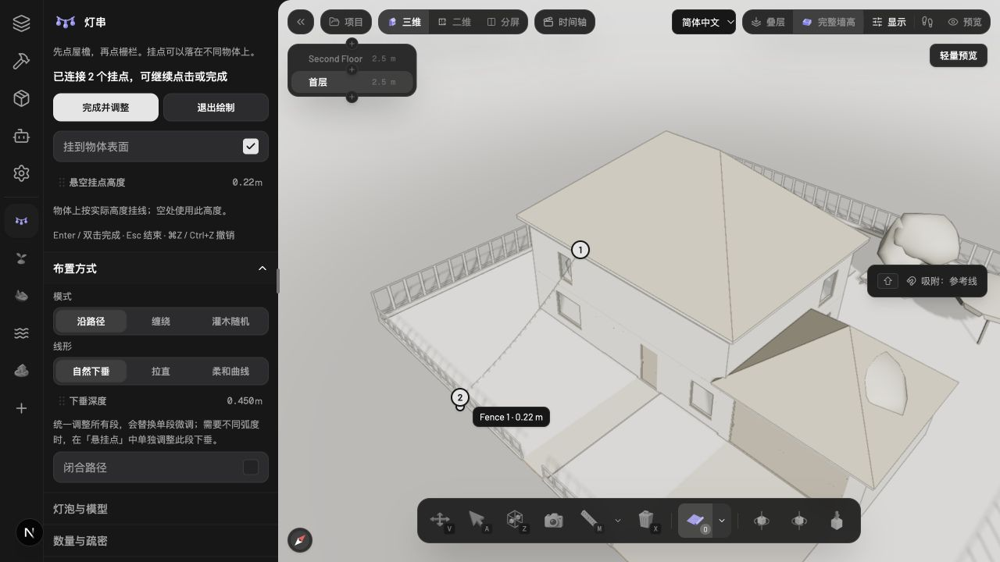
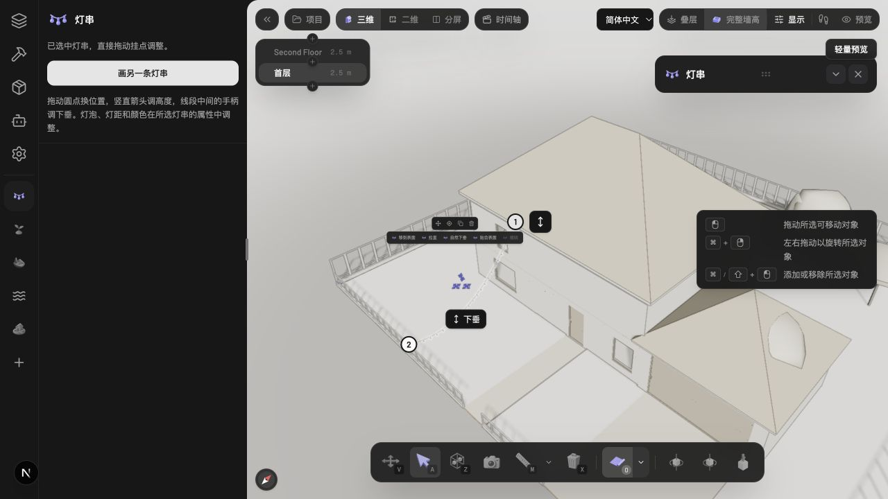

# 屋檐到栅栏：创建与编辑验收

日期：2026-10-08。本轮针对跨物体创建灯串难以落点、缺少首点反馈、完成后不能立即编辑的问题。

## 已交付

- 主入口「画灯串」不再根据当前选中物体自动限定宿主；三维默认可命中所有可见楼层。显式限定模型、贴合/缠绕和灌木入口保留。
- 首点编号、当前表面名称和高度可见。实际表面点优先；未直接命中时，在 3 / 6 像素邻域查询真实表面，帮助点中细杆。空处按高度平面与鼠标射线求交。
- 点「完成并调整」、Enter、双击或 Esc 后退出工具并选中结果。已选中灯串时，左侧不再显示另一套创建参数。
- 编号挂点直接拖动；竖直箭头 / Shift 拖动只改 Y；线段手柄只改当前段下垂。拖动预览不写历史，松手一次提交，Esc 取消。
- 灯泡、数量、颜色和自然变化默认折叠，全部参数保留。二维首点可见，完成后选中；高度和下垂仍可从属性编辑，提示文字与三维区分。

## 浏览器实测

原场景：`a1e71b066b2c`。通过本地场景 API 复制出验收副本：

<http://localhost:3002/scene/689fbfbd9ee3>

副本名：灯串跨物体优化验收 2026-10-08。原图数据与复制前逐字段比较一致。以下创建和拖动全部通过浏览器真实点击完成，API 只用于复制准备及读取保存结果。

| 检查 | 观察结果 |
| --- | --- |
| 预选房屋后开始 | 主入口仍为「画灯串」，限定模型是次要入口；主入口清除选择后开始普通绘制 |
| 第一点 | 点击二楼屋檐，显示编号 1 和 Roof 1 高度 |
| 第二点 | 点击前院栅栏，显示 Fence 1，保存两个不同宿主的锚点 |
| 完成 | 自动回到选择模式，显示编号点、高度箭头和下垂手柄 |
| 改落点 | 第二点从栅栏基座拖到上沿，保存高度 0.90 m，仍绑定栅栏 |
| 只改高度 | 从 0.90 m 拖到 2.4852248637 m，X=-3、Z=11 不变，第一点不变；仅解除第二点绑定 |
| 撤销 | 一次撤销恢复 0.90 m 和栅栏绑定 |
| 下垂 | 手柄将第一段改为 1.6122202993 m；两端坐标和两个锚点完全不变 |
| 二维 | 首点可见，第二点后 Enter 直接选中；验收试画已撤销 |
| 保存重开 | 实际刷新后灯串和手柄仍可见；场景树重新选中成功；保存的点、绑定和下垂与刷新前完全相等 |
| 面板 | 1280×720 桌面，300 px 内容侧栏和 440 px 侧栏均可读；高级参数可滚动访问 |

最终保留对象：`stringlight_28hilrwljpxlll11`，父级为首层 `level_wco9zsnp5nswywob`。

```json
{
  "points": [
    [-1.856901125939288, 5.6800754377591725, 4.876279288151835],
    [-3, 0.8999999761581421, 11]
  ],
  "hosts": ["roof_dfujjha2zje3jtl9", "fence_7b07omwlbd4winy1"],
  "spanSag": [1.612220299334326]
}
```





## 自动验证

从宿主目录使用本地 Bun 1.3.14 和 Three 测试预加载执行：

- `bun test --timeout 30000 ../string-lights-plugin/src/*.test.ts tests/integration/string-light*.test.ts`：150 项通过，13,956 个断言。
- 插件 `tsc --noEmit -p ../string-lights-plugin`：通过。
- 宿主应用 `tsc --noEmit -p apps/editor`：通过。
- `PASCAL_BOUNDARY_BUILD=1 bun run --cwd apps/editor build`：通过；构建输出隔离，不影响正在运行的开发服务。
- Impeccable 检测创建面板、绘制反馈和挂点工具：无输出问题；`git diff --check`：通过。

新增测试覆盖跨楼层和跨宿主创建、预选模型不隐式限界、显式限制保留、完成后选择、首点不提交、悬空点投影、竖直拖动和细杆邻域捕捉。

初次全量运行有一个无 DOM 测试环境的 Html 错误及一个树几何用例超时；已为纯三维测试环境跳过 DOM 标签，并在统一 30 秒超时下全量重跑通过。初轮单点零长度预览出现 WebGPU 零尺寸缓冲错误，现仅显示首点标记，非零长度后才渲染三维灯线；修复后浏览器日志未出现新的错误。

独立 `check:integration:types` 仍失败：其配置未启用 JSX，且部分第三方图片声明缺失。修复了新增用例自身的可空值检查，未扩大范围改动该全局配置；此脚本不计为通过项。

边界：本轮是参数化路径编辑；未新增绳索物理求解或自动绕障。浏览器验收为本机桌面三维 / 二维路径，未宣称其他浏览器或触屏操作已验收。

## Git 快照

- 宿主优化前快照：`cb40b2c`。
- 插件优化前快照：`394552b`。
- 实现保存在插件仓库；对应的跨层绘制集成用例保存在宿主仓库。
